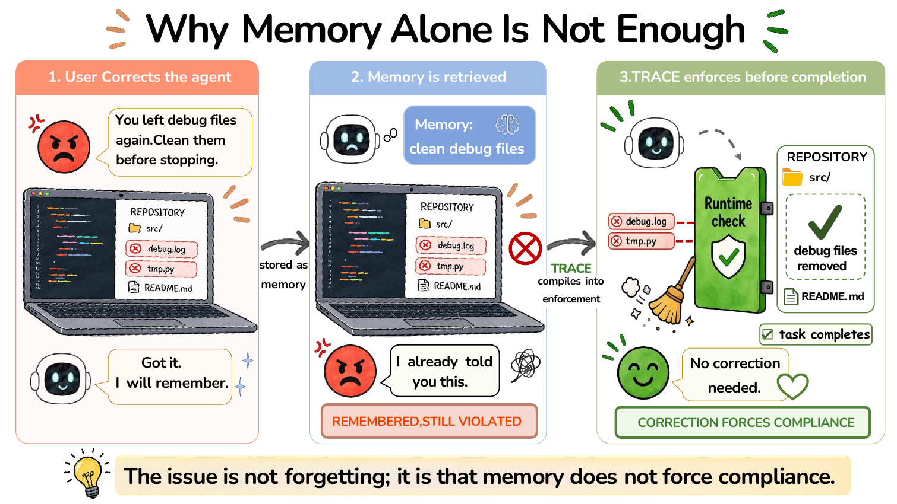

# TRACE — Test-time Rule Acquisition and Compiled Enforcement

Experiment code for the paper *"Getting Better at Working With You: Compiling
User Corrections into Runtime Enforcement for Coding Agents."*

You correct your coding agent, it acknowledges — and a few sessions later it
makes the same mistake again. Memory alone does not fix this: a correction can
be stored, retrieved, and shown to the agent, and the final output may still
violate it. **TRACE** closes that gap by *compiling* each user correction into a
runtime check that must pass before the agent is allowed to finish future
tasks — shifting personalization from passive prompt-side advice to an active
execution constraint.



On held-out ClawArena coding-agent tasks, TRACE reduces repeated preference
violations from 100.0% to 37.6% in distribution and from 100.0% to 2.0% out of
distribution, while preserving task success; on MemoryArena-derived tasks it
reduces in-distribution violations from 100.0% to 60.5% while matching or
exceeding the strongest memory baseline on task pass.

## ⚠️ Prerequisite: install the TRACE skill first

The method itself ships as a separate, deployable skill —
[**YujunZhou/preference-tracker**](https://github.com/YujunZhou/preference-tracker)
— which runs on Claude Code, GitHub Copilot CLI, and Codex. The
`trace_native_*` experiment conditions in this repository **require that skill
to be installed** (the harness wires its hooks into each per-run isolated
workspace):

```bash
# Claude Code (used by trace_native_cc)
git clone https://github.com/YujunZhou/preference-tracker.git ~/.claude/skills/preference-tracker
cd /path/to/any/project && bash ~/.claude/skills/preference-tracker/install.sh

# Codex CLI (used by trace_native_codex)
git clone https://github.com/YujunZhou/preference-tracker.git ~/.codex/skills/preference-tracker
bash ~/.codex/skills/preference-tracker/codex/install.sh
```

The baseline conditions (`no_memory`, `compiled_enforcement`) run without the
skill.

## What is in this repository

```
experiments/
├── clawarena/        # ClawArena coding-agent tasks
│   ├── clawarena/    #   Python package (runner, conditions, scoring, ...)
│   ├── scripts/run_trace_clawarena.sh
│   └── data/README.md     # how to obtain the ClawArena benchmark
└── memoryarena/      # MemoryArena agent-memory tasks (+ user-in-the-loop wrapper)
    ├── memoryarena/  #   Python package (runner, wrapper, user_simulator, ...)
    ├── scripts/run_trace_memoryarena.sh
    ├── configs/      #   experiment-design config
    └── tests/        #   unit tests for the wrapper / scoring / splits
```

## Conditions

| Condition              | What it is                                                             |
|------------------------|------------------------------------------------------------------------|
| `trace_native_cc`      | TRACE running natively as a **Claude Code** skill (runtime hooks).      |
| `trace_native_codex`   | TRACE running natively as a **Codex CLI** skill (runtime hooks).        |
| `no_memory`            | Trivial control: the agent with no memory and no rules.                 |
| `compiled_enforcement` | Prompt-side variant that injects the compiled rules into the prompt.    |

The third-party memory-system baselines reported in the paper (Mem0, Hindsight,
ReMe-Light) run against their official SDKs and are **not** redistributed here.

## Reproducing the experiments

1. **Install the TRACE skill** (see the prerequisite box above).
2. **Get the benchmark data** (not redistributed):
   [`experiments/clawarena/data/README.md`](experiments/clawarena/data/README.md)
   for ClawArena and
   [`experiments/memoryarena/data/splits/README.md`](experiments/memoryarena/data/splits/README.md)
   for MemoryArena (HuggingFace) plus the seeded row splits.
3. **Dry-run the pipeline** without any model call to verify your setup:
   use `--runtime oracle_dry_run` (ClawArena) or the `oracle_dry_run` runtime
   (MemoryArena).
4. **Run a condition**:

```bash
# ClawArena (one condition per invocation)
cd experiments/clawarena
CLAWARENA_ROOT=/path/to/ClawArena \
  scripts/run_trace_clawarena.sh trace_haiku claude_cli haiku trace_native_cc
# → records.jsonl + summary_metrics.json under state/runtime/trace_haiku/

# MemoryArena
cd experiments/memoryarena
scripts/run_trace_memoryarena.sh trace_native_cc claude_cli haiku
# → records.jsonl under state/runtime/.../
```

Each run uses the simulated user-in-the-loop protocol with frozen
in-distribution / out-of-distribution evaluation: corrections are collected on
the training stream, the compiled rule library is then frozen, and held-out
tasks measure **violation rate**, **task pass**, and **mean corrections**
(plus test-time efficiency on ClawArena). See
[`experiments/README.md`](experiments/README.md) for the full protocol and
metric definitions.

Unit tests for the harness components:

```bash
cd experiments/memoryarena && python3 -m pytest tests/ -q
```

## Privacy note

The diagnostic correction stream studied in the paper comes from real working
sessions and is not redistributed. Everything in this repository runs locally;
no telemetry, no third-party services beyond the agent CLIs you already use.

## License

MIT — see [`LICENSE`](LICENSE).
